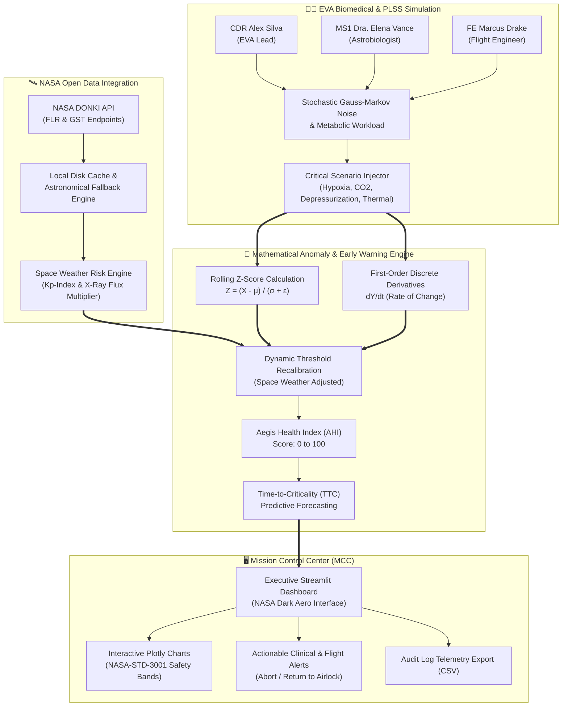

# 🛡️ Aegis-EVA: Astronaut Health & Predictive Telemetry System

[](https://www.spaceappschallenge.org/)
[](https://www.python.org/)
[](https://streamlit.io/)
[](https://plotly.com/)
[](LICENSE)

> **Team:** Galactic Engineering BR-US  
> **Challenge:** Create Astronaut Health Monitoring Software for Space Missions  
> **System:** Real-Time Extravehicular Activity (EVA) Biomedical Telemetry, Space Weather Sensor Fusion & Predictive Anomaly Diagnostics

---

## 🌟 Executive Summary

During Extravehicular Activity (EVA) spacewalks on lunar or deep space missions, astronauts face lethal physiological hazards, from **hypoxia** and **hypercapnia** (CO₂ accumulation) to **sudden EMU suit depressurization** and **extreme solar radiation events**. Conventional systems trigger reactive alarms only after physiological thresholds have already been breached.

**Aegis-EVA** bridges this critical gap by delivering an end-to-end, predictive health and life-support monitoring architecture. It fuses live astronomical telemetry from **NASA DONKI** (Solar Flares and Geomagnetic Storms) with multi-crew physiological sensors (ECG/HRV, SpO₂, core temperature, suit pressure, and CO₂ partial pressure). By deploying **rolling Z-scores** and **discrete first-order derivatives ($\frac{dY}{dt}$)**, Aegis-EVA detects subtle physiological deterioration up to **15 minutes before physical collapse**, predicting **Time-to-Criticality (TTC)** and dynamically calibrating mission safety envelopes.

---

## 🏗️ System Architecture



---

## 📐 Mathematical Formulation

### 1. Rolling Z-Score (Signal Deviation Detection)
To detect early-stage anomalous physiological deviation independently of baseline drift:
$$Z_t = \frac{X_t - \mu_w}{\sigma_w + \epsilon}$$
Where:
- $X_t$ is the instantaneous telemetry reading at time $t$.
- $\mu_w$ and $\sigma_w$ are the rolling mean and standard deviation over window $w = 10$.
- $\epsilon = 10^{-6}$ provides numerical stability against division by zero during quiescent periods.

### 2. First-Order Discrete Derivative (Trend and Rate of Change)
Captures the velocity of physiological decay before absolute thresholds are violated:
$$\frac{dY}{dt} \approx \frac{Y_t - Y_{t-1}}{\Delta t}$$
Where $\Delta t$ is the telemetry sampling period ($30\text{ seconds} = 0.5\text{ min}$). A persistent $\frac{d(\text{SpO}_2)}{dt} < -0.3\%/\text{min}$ triggers predictive hypoxia warnings even when $\text{SpO}_2 > 95\%$.

### 3. Space Weather Adaptive Threshold Recalibration
When NASA DONKI detects active solar flare radiation ($\lambda_{\text{solar}}$) or severe geomagnetic storms ($Kp \ge 5.0$):
$$T_{\text{adapted}} = \frac{T_{\text{base}}}{\max(\kappa \cdot \lambda_{\text{solar}}, 1.0)}$$
Allowing dosimetric alert levels to tighten proactively, safeguarding crew members from Acute Radiation Sickness (ARS).

### 4. Time-to-Criticality (TTC) Estimation
$$\text{TTC} = \frac{|Y_{\text{critical}} - Y_t|}{\left|\frac{dY}{dt}\right|}$$
Provides flight surgeons with an estimated window in minutes before the astronaut reaches irreversible physiological impairment.

### 5. Aegis Health Index (AHI)
A unified composite score (0 to 100) reflecting overall astronaut survivability:
$$\text{AHI} = \max\left(5.0, \min\left(100.0, 100.0 - \sum_{i=1}^{M} w_i \cdot P_i\right)\right)$$

---

## 📋 NASA Physiological Standards Baseline (NASA-STD-3001)

| Parameter | Nominal Range | Caution / Warning | Critical Abort | Clinical Risk |
| :--- | :---: | :---: | :---: | :--- |
| **Heart Rate (BPM)** | $60 - 100$ | $> 125$ | $> 150$ | Tachycardia / Cardiac Decompensation |
| **SpO₂ (%)** | $95.0 - 100.0\%$ | $< 92.0\%$ | $< 88.0\%$ | Cerebral Hypoxia / Loss of Consciousness |
| **Suit Pressure (kPa)** | $28.5 - 31.0$ | $< 26.5$ | $< 24.0$ | Decompression Sickness / Ebullism |
| **Suit CO₂ (mmHg)** | $1.5 - 3.8$ | $> 5.5$ | $> 8.0$ | Hypercapnia / LiOH Canister Satiation |
| **Core Temp (°C)** | $36.5 - 37.5$ | $> 38.3$ | $> 39.2$ | Heat Exhaustion / LCVG Cooling Failure |
| **Radiation (mSv/h)** | $0.02 - 0.06$ | $> 0.25$ | $> 0.80$ | Solar Particle Event (SPE) Exposure |

---

## 🛠️ Project Structure

```
aegis-eva-nasa-space-apps/
├── app.py                      # Main Streamlit Executive Dashboard
├── requirements.txt            # Lightweight dependencies (Termux/ARM64 and Cloud)
├── README.md                   # International Technical Documentation
├── .gitignore                  # Git hygiene rules
├── data/                       # Local JSON cache for NASA DONKI telemetry
│   ├── flr_cache.json          # Cached Solar Flares
│   └── gst_cache.json          # Cached Geomagnetic Storms
└── src/
    ├── __init__.py             # Package initializer
    ├── nasa_api.py             # NASA DONKI API client with fallback resilience
    ├── biometrics_engine.py    # Multi-astronaut stochastic physiological simulation
    └── anomaly_detector.py     # Mathematical predictive engine (Z-score & derivatives)
```

---

## 🚀 Quickstart & Execution

### 1. Prerequisites
- Python 3.10, 3.11, 3.12, 3.13 or 3.14
- Git configured with SSH

### 2. Installation
```bash
# Clone the repository
git clone git@github.com:santiago2511/aegis-eva-nasa-space-apps.git
cd aegis-eva-nasa-space-apps

# Install dependencies
pip install -r requirements.txt
```

### 3. Running Component Tests
```bash
# Test NASA DONKI API client
python3 src/nasa_api.py

# Test Multi-Astronaut Biometrics Engine
python3 src/biometrics_engine.py

# Test Mathematical Anomaly Detector
python3 src/anomaly_detector.py
```

### 4. Launching the Mission Control Dashboard
```bash
streamlit run app.py
```
Open `http://localhost:8501` in your browser.

---

## 👨‍💻 Team Galactic Engineering BR-US
- **Mission:** NASA Space Apps Challenge 2026 / Global Hackathon
- **Focus:** Aerospace Bioengineering, Space Medicine & Embedded Real-Time Telemetry

*Dedicated to the safety of extravehicular explorers pioneering the Moon, Mars, and beyond.*
